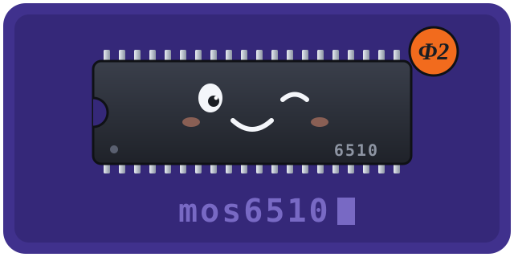

<p align="center">
  
</p>

<p align="center">
  <b>A cycle-exact MOS 6510 / 6502 core in Rust.</b><br>
  One tick, one bus access, no excuses.
</p>

---

> **Status:** under construction. The core is being written against the test
> suites described below; this notice goes away when they all pass.

## Why another 6502 in Rust?

Fair question. crates.io already has a respectable pile of them, and writing a
6502 emulator is practically a rite of passage, somewhere between "hello world"
and "my own Lisp".

This one exists because of a SID chip. The rust-sid project plays Commodore 64
music by running each tune's own 6510 code and feeding its register writes to
an emulated SID. It borrowed a CPU crate off the shelf, and out of 16 tunes
sampled from the High Voltage SID Collection, 13 played nothing but silence.

What followed was a long investigation into the tunes. Memory layout, power-on
state, interrupts, the raster counter, the Kernal ROM: all checked, all
innocent. The conclusion written down at the time was that the tunes "had
decided not to play".

The tunes had not decided anything. Running the CPU against a standard 6502
test suite turned up the real culprits:

- `LDA (ptr),Y` never added Y. Every music player walks its note data that way.
- `ADC` and `SBC` never touched the carry flag, so no 16-bit sum ever carried.
- `SBC` subtracted the carry instead of the borrow, an off-by-one in every
  subtraction.
- `PHP` turned the Break flag into Carry on its way to the stack.
- Every undocumented opcode was a polite no-op.

With those instructions patched around, all 16 tunes played. A patch layer over
a CPU that fails its test suite is not a foundation, though, so this crate is
the replacement: written from the documentation, and held to tests that check
every bus access of every cycle of every opcode.

No shade intended to anyone's hobby project. Writing a 6502 is easy. Writing
one that is right is where it gets interesting.

## What it does

| | |
|---|---|
| **Timing** | `Cpu::tick` runs one Φ2 cycle and performs exactly one bus access, dummy reads and the read-modify-write double write included. |
| **Opcodes** | All 256: the 151 documented ones, the stable undocumented ones (`LAX`, `SAX`, `DCP`, `ISC`, `SLO`, `RLA`, `SRE`, `RRA`, `ANC`, `ALR`, `ARR`, `SBX`), the unstable ones (`ANE`, `LXA`, `SHA`, `SHX`, `SHY`, `TAS`, `LAS`) and the twelve `JAM`s. |
| **Decimal mode** | NMOS behaviour, including the flags it sets on invalid BCD. |
| **Interrupts** | IRQ level-triggered, NMI edge-triggered, polled in the penultimate cycle like the real part. The instruction after `CLI` still runs first, a taken branch can delay an IRQ, and an NMI can hijack a `BRK`. |
| **6510 port** | `$00`/`$01` with direction and data registers and input pins (`Model::Mos6510`), or none at all (`Model::Mos6502`). |
| **Hygiene** | No dependencies. No `unsafe`. MIT or Apache-2.0. |

## Quick start

```rust
use mos6510::{Bus, Cpu, Model};

struct Ram(Vec<u8>);

impl Bus for Ram {
    fn read(&mut self, addr: u16) -> u8 {
        self.0[usize::from(addr)]
    }
    fn write(&mut self, addr: u16, value: u8) {
        self.0[usize::from(addr)] = value;
    }
}

let mut ram = Ram(vec![0; 0x1_0000]);
let mut cpu = Cpu::new(Model::Mos6510); // the first seven ticks are the reset sequence
for _ in 0..1_000 {
    cpu.tick(&mut ram);
}
```

`Bus::read` takes `&mut self` on purpose: on real hardware reading a register
can change it (a CIA clears its interrupt flags when they are read), and an
emulator that pretends otherwise ends up with interior mutability everywhere.

Driving it from a host, such as a music player calling a routine directly:

```rust
cpu.a = 0;                  // subtune number
cpu.jump(0x1000);           // abandon whatever was happening, start here
cpu.set_irq(cia_line);      // wire your interrupt sources to the pins
if cpu.interrupt_pending() { /* count it, log it, frame it */ }
```

## The quirks, faithfully reproduced

Bugs that real programs depend on are features. This core keeps them:

- `JMP ($xxFF)` fetches its high byte from `$xx00`, as the NMOS part always has.
- Read-modify-write instructions write the old value back before the new one.
  Some hardware notices.
- Indexed reads that cross a page do a dummy read at the wrong address first.
- `ANE` and `LXA` OR the accumulator with a "magic constant" that varies from
  chip to chip and with temperature. Ours is `$EE`
  (`mos6510::UNSTABLE_MAGIC`), the value the test data records. Ours does not
  vary with temperature.
- `JAM` locks the CPU solid until reset, reading `$FFFF` forever with great
  dedication.

## How it is tested

Not "it boots a game, ship it". The tests are:

- **Tom Harte's [SingleStepTests](https://github.com/SingleStepTests/65x02)**
  (MIT): 10,000 cases for each of the 256 opcodes, each one checking the
  address, value and direction of every bus access in every cycle, then the
  final registers and memory. About half of the arithmetic cases run in
  decimal mode with arbitrary operands.
- **Klaus Dormann's
  [functional test](https://github.com/Klaus2m5/6502_65C02_functional_tests)**:
  a 6502 program that exercises the whole instruction set and halts at a
  known address only if everything worked.
- **Hand-written tests** for what neither suite can see: interrupt timing,
  reset, `JAM`, and the 6510 port.

The test data is not in the repository (one suite is 1.3 GB, the other is
GPL-3.0). Fetch it, then run:

```sh
sh scripts/fetch-harte.sh
sh scripts/fetch-klaus.sh
HARTE_DIR=target/test-data/harte KLAUS_DIR=target/test-data/klaus cargo test --release
```

Without the data, those two tests print that they were skipped and pass.

## What it does not do

- 65C02, 65816, or the NES 2A03. Different chips, different bugs.
- The RDY line and VIC-II bus stealing. The design leaves room for it.
- The slow fade of undriven 6510 port bits. The pins read what you tell them.

## Licence

MIT OR Apache-2.0, at your option.

Behaviour comes from documentation and test data. Permissively licensed
emulators were used only to cross-check behaviour, and no GPL emulator source
was consulted, so the crate can carry a permissive licence with a clear
conscience.
